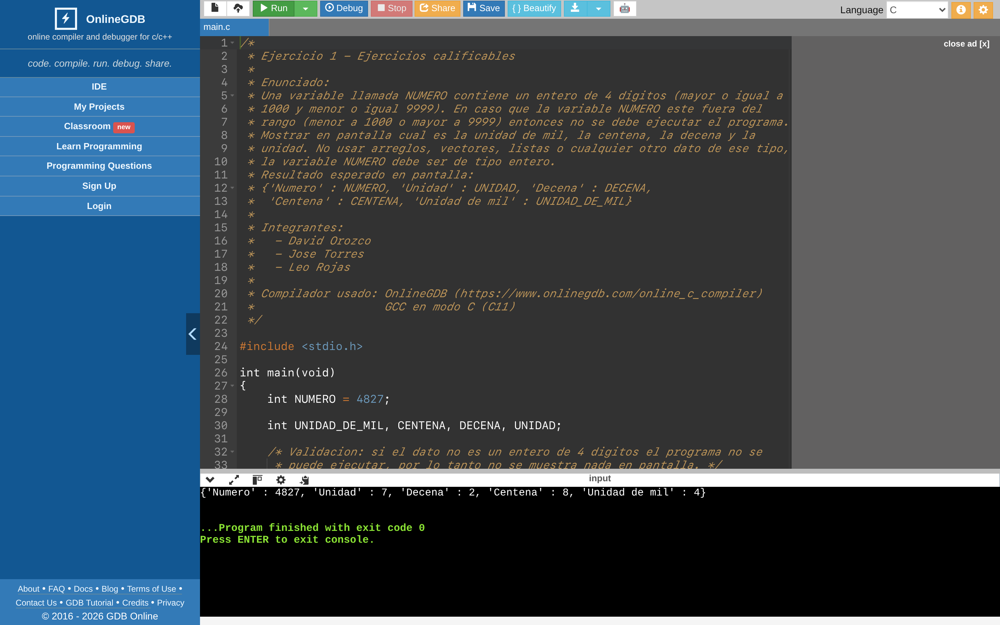
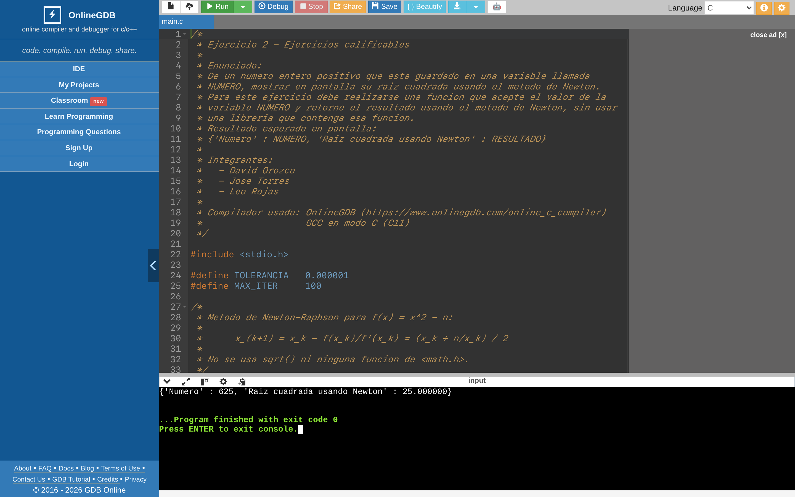
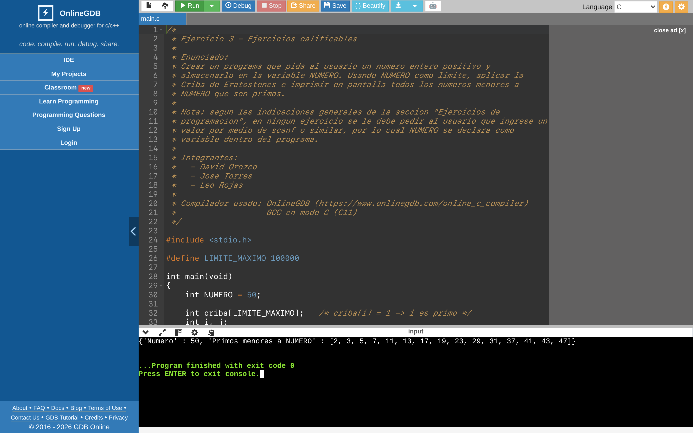
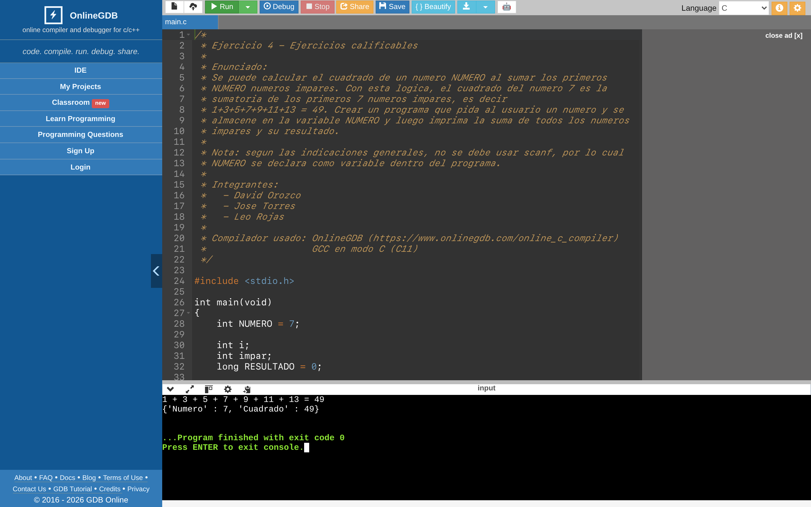
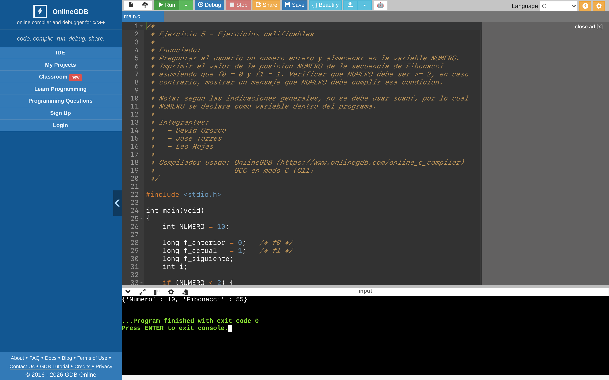
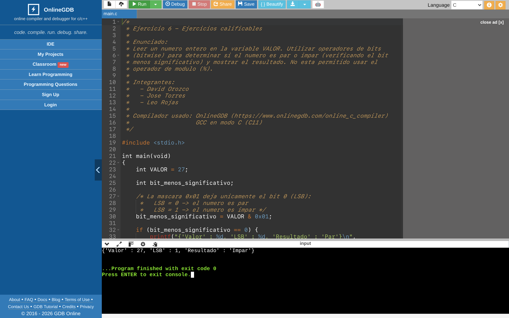
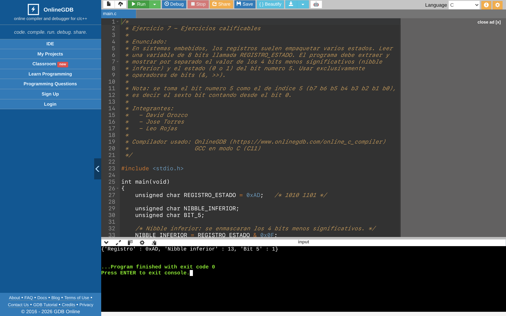
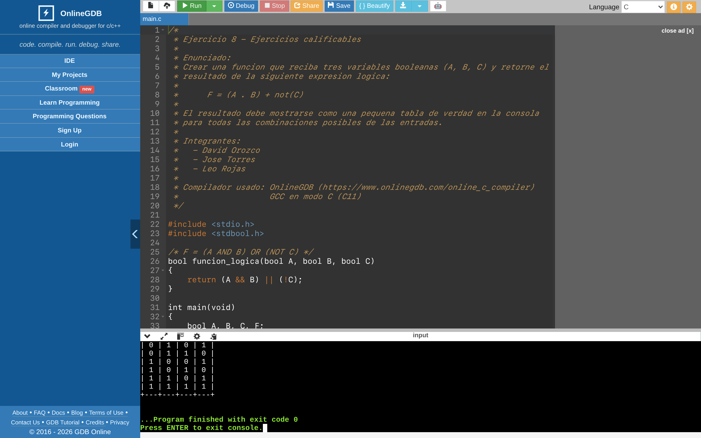
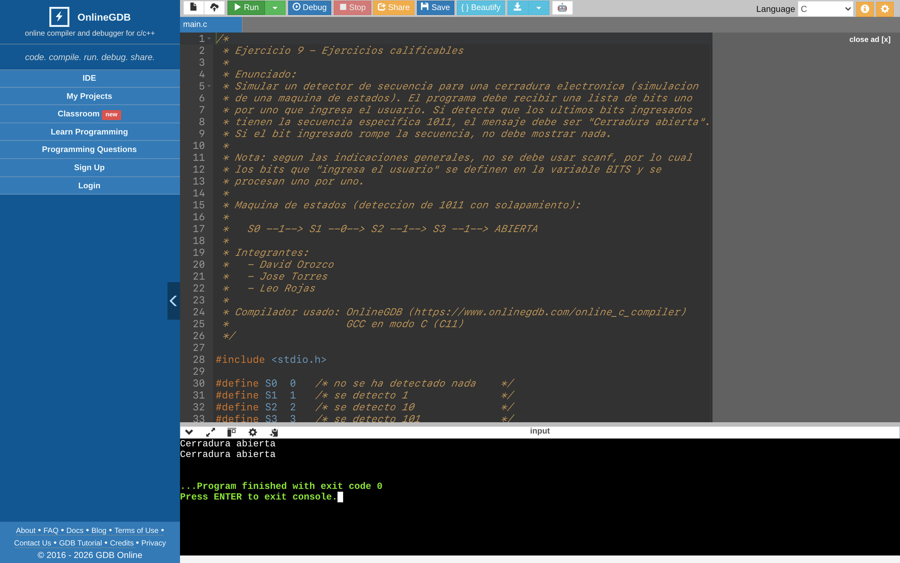
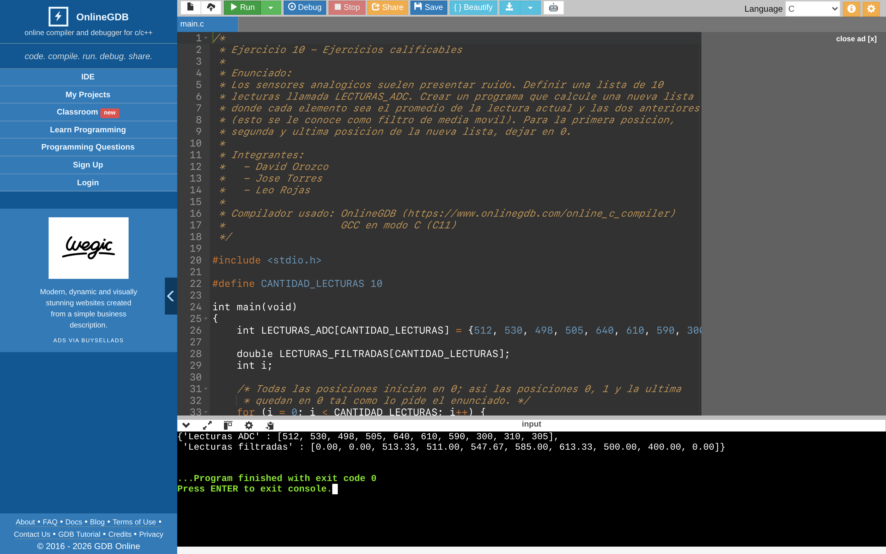

# Sistemas Embebidos 1

Repositorio del grupo para las actividades de la asignatura **Sistemas Embebidos 1**.

## Integrantes del grupo

- David Orozco
- Jose Torres
- Leo Rojas

## Contenido del repositorio

```
.
+-- proyecto-de-aula
|   +-- c1-idea-aprobada-de-proyecto.txt
+-- ejercicios-de-programacion
|   +-- ejercicio-01-descomposicion-de-numero.c
|   +-- ejercicio-02-raiz-cuadrada-newton.c
|   +-- ejercicio-03-criba-de-eratostenes.c
|   +-- ejercicio-04-cuadrado-suma-impares.c
|   +-- ejercicio-05-fibonacci.c
|   +-- ejercicio-06-par-impar-bitwise.c
|   +-- ejercicio-07-registro-estado.c
|   +-- ejercicio-08-tabla-de-verdad.c
|   +-- ejercicio-09-detector-de-secuencia.c
|   +-- ejercicio-10-filtro-media-movil.c
+-- capturas/               (capturas de OnlineGDB)
+-- Makefile
+-- README.md
```

## Ejercicios calificables

Corresponden a la seccion **3.2.5. Ejercicios de programacion**, apartado
*Ejercicios calificables*, del material de la asignatura.

| # | Archivo | Tema |
|---|---------|------|
| 1 | `ejercicio-01-descomposicion-de-numero.c` | Unidad, decena, centena y unidad de mil de un entero de 4 digitos |
| 2 | `ejercicio-02-raiz-cuadrada-newton.c` | Raiz cuadrada por el metodo de Newton (sin `math.h`) |
| 3 | `ejercicio-03-criba-de-eratostenes.c` | Numeros primos con la Criba de Eratostenes |
| 4 | `ejercicio-04-cuadrado-suma-impares.c` | Cuadrado de un numero como suma de los primeros N impares |
| 5 | `ejercicio-05-fibonacci.c` | Termino N de la secuencia de Fibonacci |
| 6 | `ejercicio-06-par-impar-bitwise.c` | Par/impar usando operadores de bits (sin `%`) |
| 7 | `ejercicio-07-registro-estado.c` | Extraccion de nibble inferior y bit 5 de un registro de 8 bits |
| 8 | `ejercicio-08-tabla-de-verdad.c` | Tabla de verdad de `F = (A·B) + ¬C` |
| 9 | `ejercicio-09-detector-de-secuencia.c` | Maquina de estados: detector de la secuencia `1011` |
| 10 | `ejercicio-10-filtro-media-movil.c` | Filtro de media movil sobre 10 lecturas de ADC |

## Criterios aplicados

Segun las indicaciones de la seccion 3.2.5 del material:

- Cada ejercicio esta en un **archivo independiente**, cuyo nombre indica el numero del ejercicio.
- Cada archivo inicia con un **comentario de multiples lineas** que contiene el enunciado,
  los nombres de los integrantes y el compilador utilizado.
- **No se usa `scanf`** ni ninguna forma de entrada por teclado: los datos de entrada se
  declaran como variables dentro de cada programa.
- Si el dato de entrada no es valido para el programa, este **no muestra nada en pantalla**
  o muestra el mensaje de error correspondiente, segun lo indique cada enunciado.
- La salida imita el formato de diccionario de Python / JSON cuando el enunciado lo especifica.

## Compilador utilizado

Los programas fueron desarrollados y probados en el compilador en linea
**OnlineGDB**: <https://www.onlinegdb.com/online_c_compiler> (GCC, estandar C11).

### Como probar cada programa en OnlineGDB

1. Abrir <https://www.onlinegdb.com/online_c_compiler>.
2. Seleccionar el lenguaje **C** en la lista desplegable de la esquina superior derecha.
3. Copiar el contenido completo de uno de los archivos `.c` y pegarlo en el editor.
4. Presionar **Run** y observar la salida en la consola inferior.
5. Para probar otros valores, modificar unicamente la variable de entrada declarada
   al inicio de `main` (por ejemplo `NUMERO`, `VALOR`, `REGISTRO_ESTADO`).

## Capturas de pantalla

Ejecucion de cada programa en el compilador en linea **OnlineGDB**
(<https://www.onlinegdb.com/online_c_compiler>). Las imagenes estan en la carpeta `capturas/`.

### Ejercicio 1 — Unidad, decena, centena y unidad de mil



### Ejercicio 2 — Raiz cuadrada por el metodo de Newton



### Ejercicio 3 — Criba de Eratostenes



### Ejercicio 4 — Cuadrado como suma de impares



### Ejercicio 5 — Secuencia de Fibonacci



### Ejercicio 6 — Par o impar con operadores de bits



### Ejercicio 7 — Nibble inferior y bit 5 de un registro



### Ejercicio 8 — Tabla de verdad F = (A·B) + ¬C



### Ejercicio 9 — Detector de secuencia 1011



### Ejercicio 10 — Filtro de media movil


## Como compilar y ejecutar localmente

Requisitos: `gcc` y `make`.

```bash
# Compilar todos los ejercicios (los binarios quedan en build/)
make

# Compilar y ejecutar todos los ejercicios en orden
make run

# Compilar y ejecutar un ejercicio puntual
make run-03

# Eliminar los binarios generados
make clean

# Ver la ayuda
make help
```

Tambien se puede compilar un archivo de forma manual:

```bash
gcc -std=c11 -Wall -Wextra -o ejercicio-01 ejercicios-de-programacion/ejercicio-01-descomposicion-de-numero.c
./ejercicio-01
```
